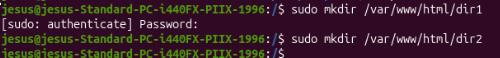
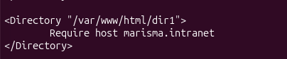
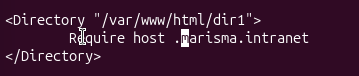
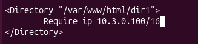
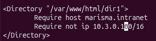
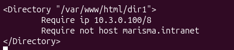

# Actividad 3 - Dir
1. Crea un directorio llamado "dir1" y otro llamado "dir2"
	Lo primero que tenemos que hacer es acceder al directorio ``/var/www/html`` y después de acceder al directorio tenemos que poner el siguiente comando para crear los siguientes directorios
  ```console
  sudo mkdir /var/www/html/dir1
  sudo mkdir /var/www/html/dir2
  ```



2. Explica qué diferencia existe entre ambos y muestra su equivalencia con la directiva Require:
<Directory /var/www/example1>
Order Deny,Allow
Deny from All
Allow from 192.168.1.100
</Directory>
  **Esta niega el acceso a todos excepto a 192.168.1.100**

<Directory /var/www/example1>
Order Allow,Deny
Deny from All
Allow from 192.168.1.100
</Directory>
**Y esta niega el acceso a todos**
		
3. Para dir1
  a) Permite el acceso de las peticiones provenientes de 10.3.0.100
	Primero tenemos que entrar en el archivo de configuración de apache para editarlo y después poner las siguientes lineas
	```console
 	<Directory "/var/www/html/dir1">
 		Require ip 10.3.0.100
 	</Directory>
 	```
 
	
 
  b) Permite el acceso desde "marisma.intranet"
	Entramos al fichero apache2.conf para editar la configuración y  introducimos o mejor dicho cambiamos la linea que hicimos anteriormente
	```console
 	<Directory "/var/www/html/dir1">
 		Require host marisma.intranet
 	</Directory>
 	```


	
  c) Permite el acceso desde cualquier subdominio de "marisma.intranet"
	Entramos al fichero apache2.conf para editar la configuración y cambiamos la linea anteriormente hecha aunque esta vez solo hay que añadir un . delante del host para que entienda que los subdominios también pueden acceder.
	```console
 	<Directory "/var/www/html/dir1">
 		Require host .marisma.intranet
 	</Directory>
 	```


	
  D) Permite el acceso de las peticiones provenientes de "10.3.0.100" con máscara "255.255.0.0"
	Entramos al fichero apache2.conf para editar la configuración y cambiamos la linea anteriormente hecha por las siguientes lineas.
	```console
 	<Directory "/var/www/html/dir1">
 		Require ip 10.3.0.100/16
 	</Directory>
 	```




4. Modifica la configuración de forma que el acceso a dir1:
  a) Se permita a "marisma.intranet" y no se permita desde 10.3.0.101"
	Entramos al fichero apache2.conf para editar la configuración y cambiamos la linea anteriormente hecha por las siguientes lineas.
	```console
 	<Directory "/var/www/html/dir1">
 		Require host marisma.intranet
 		Require not ip 10.3.0.101/16
 	</Directory>
 	```
 
	
6. Modifica la configuración de forma que el acceso a dir2:
  a) Se permita a "10.3.0.100/8" y no a "marisma.intranet"
	```console
 	<Directory "/var/www/html/dir1">
 		Require not host marisma.intranet
 		Require ip 10.3.0.100/8
 	</Directory>
 	```
 
