# Activiadad4
Escribe las expresiones regulares para los siguientes supuestos:
**Directorios en /www/ cuyo nombre consista en tres dígitos.**
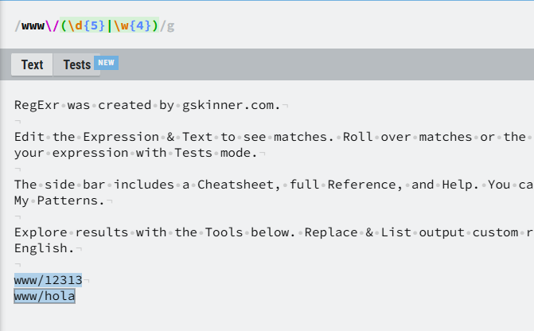

**Ficheros:** *.gif, *.jpeg, *.jpg, *.png 
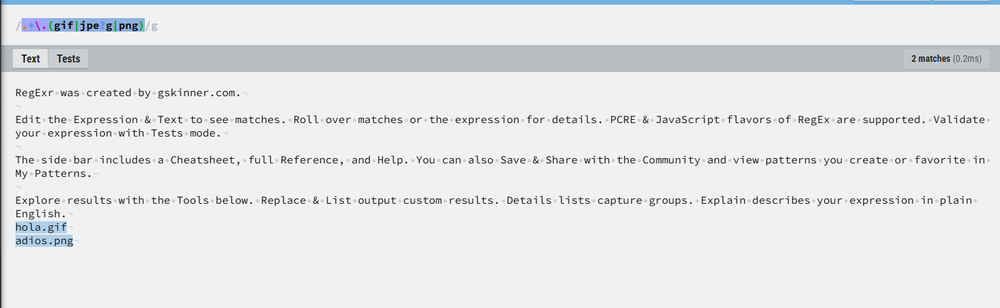

**Escribe una directiva para redireccionar todos los GIF a ficheros JPEG en otro servidor**

RedirectMatch "(.+)\.gif$" "http://other.example.com/$1.jpg"

**Números enteros y decimales**
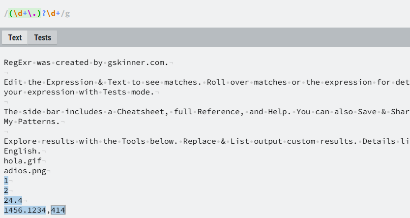

**Números de teléfono en el formato Americano: 123-123-1234**
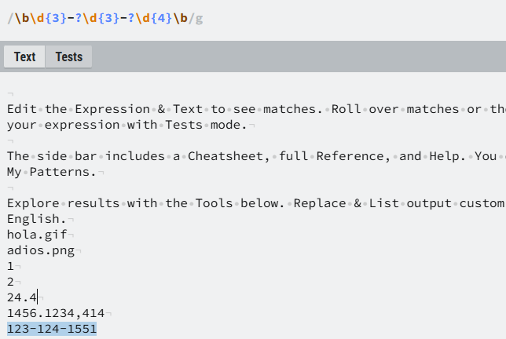

**Palabras**
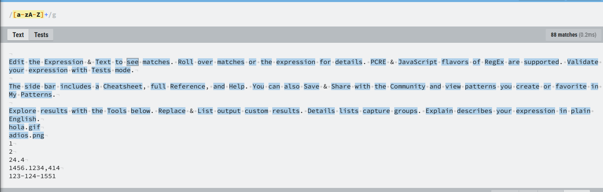

**Códigos hexadecimales de color de 24 o 32 bits**

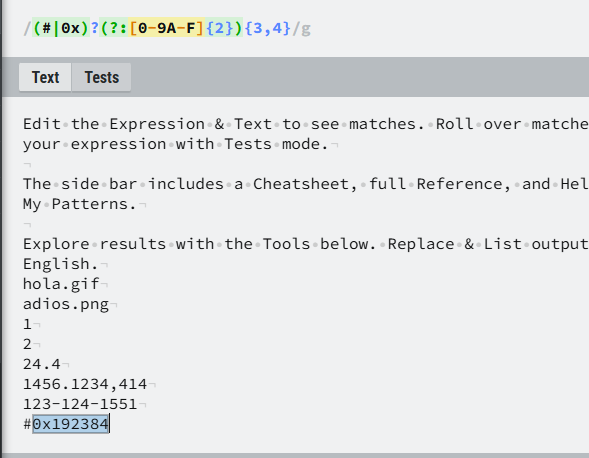

**Palabras de 4 letras**
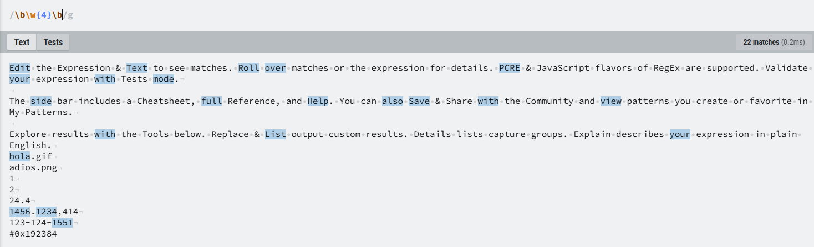

**Número entero sin signo**

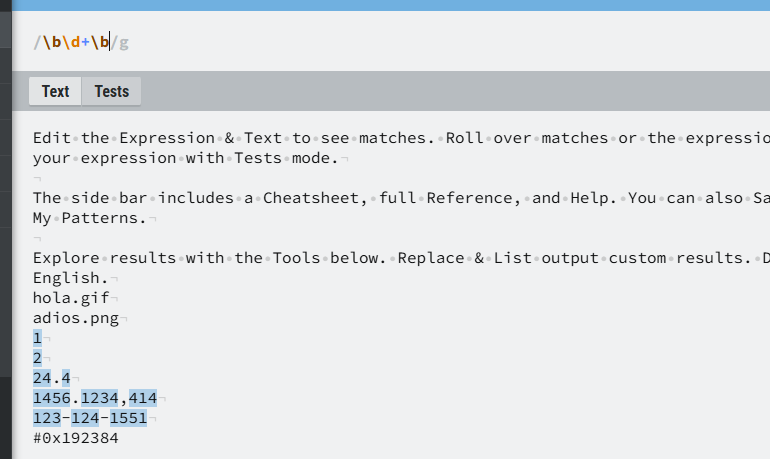

**Número entero con signo**

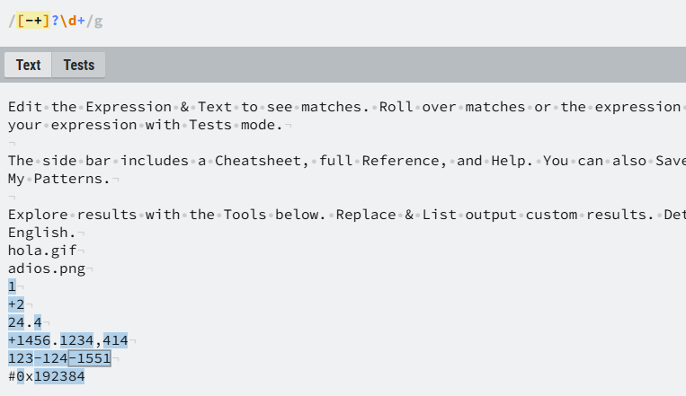

**Números reales**

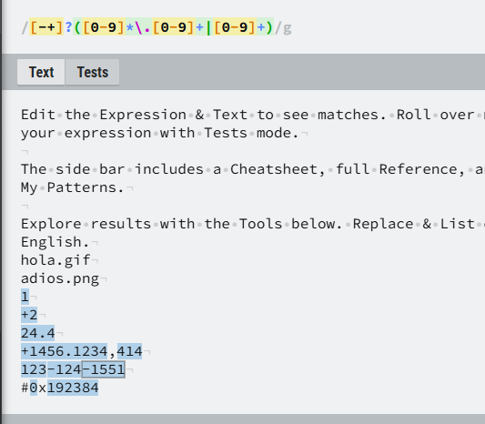

**Número reales con exponente**

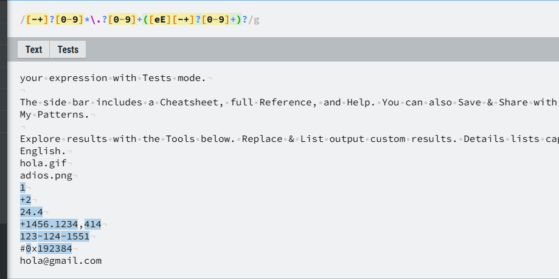

**Email**

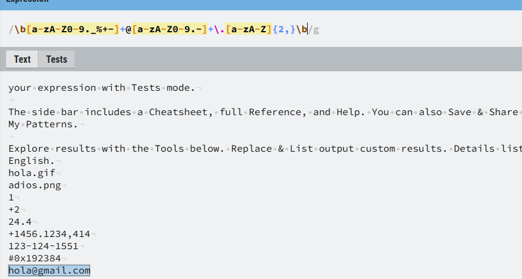

**Números del 0 a 255**

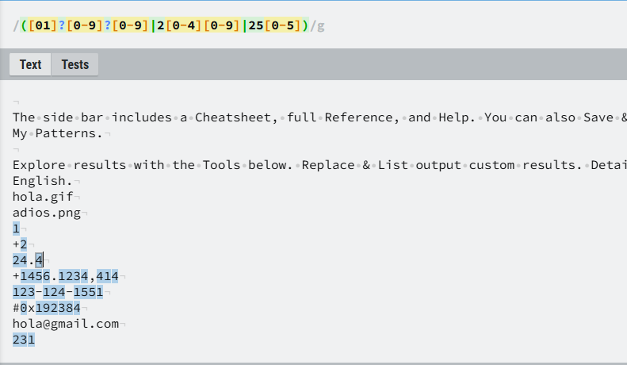
