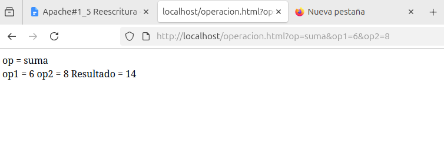
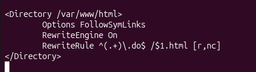

# Activiadad5
## Ejemplo 1: Reescribir URL
Para reescribir la URL primero tenemos que habilitar el modulo Rewrite para ello pondremos el siguiente comando ``sudo a2enmod rewrite``
Lo siguiente seria entrar en el fichero de configuración y escribir las siguientes lineas:
```bash
<Directory /var/www/html>
  Options FollowSymLinks
  RewriteEngine ON
  RewriteRule ^operacion.html$ operacion.php
</Directory>
```


Por ultimo reiniciamos el servicio de apache para aplicar los cambios y ya estaría todo de parte de la configuración
Y ahora para probarlo tenemos que poner la siguiente URL en el navegador **http://localhost/operacion.html?op=suma&op1=6&op2=8**

 

## Ejemplo 2: Cambiar la extensión de los ficheros
Para cambiar la extensión de los ficheros tenemos que entrar en el fichero de configuración y escribir las siguientes lineas:
```bash
<Directory /var/www/html>
  Options FollowSymLinks
  RewriteEngine ON
  RewriteRule ^(.+)\.do$ /$1.html [nc]
</Directory>
```
Esto puede ser penalizado por los motores de búsqueda ya que podemos acceder a la misma página con dos URL distintas, para solucionar esto podemos hacer una redirección:
```bash
<Directory /var/www/html>
  Options FollowSymLinks
  RewriteEngine ON
  RewriteRule ^(.+)\.do$ /$1.html [r, nc]
</Directory>
```


Ahora si escribimos en el navegador **http://localhost/operacion.do** nos redirigirá a **http://localhost/operacion.html**

## Ejemplo 3: Crear URL amigables
