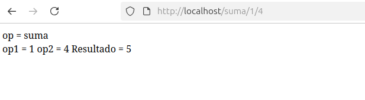
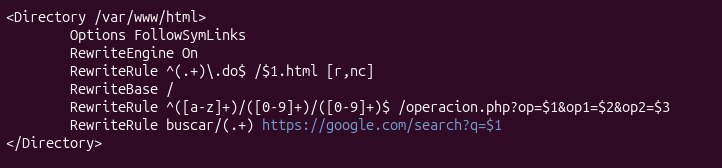
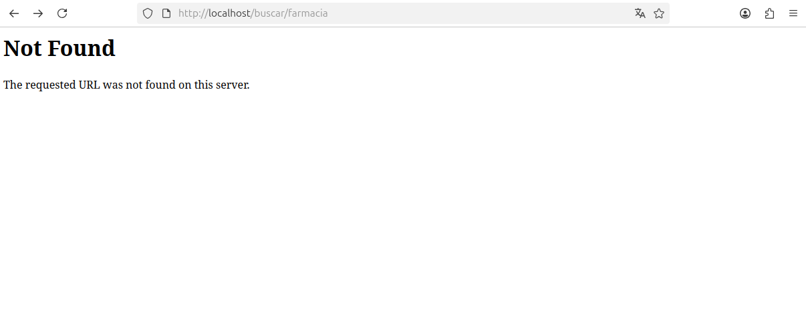
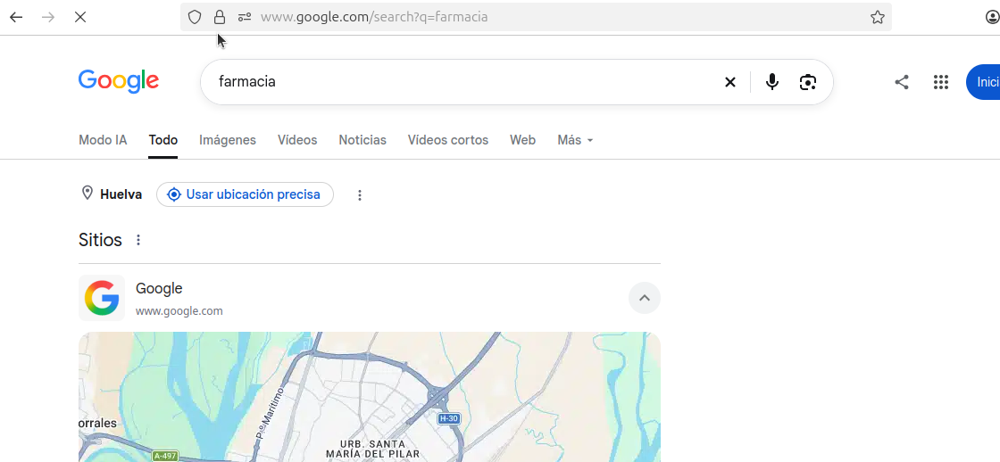

# Activiadad5
## Ejemplo 1: Reescribir URL
Para reescribir la URL primero tenemos que habilitar el modulo Rewrite para ello pondremos el siguiente comando ``sudo a2enmod rewrite``
Lo siguiente seria entrar en el fichero de configuración y escribir las siguientes lineas:
```bash
<Directory /var/www/html>
  Options FollowSymLinks
  RewriteEngine ON
  RewriteRule ^operacion.html$ operacion.php
</Directory>
```


Por ultimo reiniciamos el servicio de apache para aplicar los cambios y ya estaría todo de parte de la configuración
Y ahora para probarlo tenemos que poner la siguiente URL en el navegador **http://localhost/operacion.html?op=suma&op1=6&op2=8**


 

## Ejemplo 2: Cambiar la extensión de los ficheros
Para cambiar la extensión de los ficheros tenemos que entrar en el fichero de configuración y escribir las siguientes lineas:
```bash
<Directory /var/www/html>
  Options FollowSymLinks
  RewriteEngine ON
  RewriteRule ^(.+)\.do$ /$1.html [nc]
</Directory>
```
Esto puede ser penalizado por los motores de búsqueda ya que podemos acceder a la misma página con dos URL distintas, para solucionar esto podemos hacer una redirección:
```bash
<Directory /var/www/html>
  Options FollowSymLinks
  RewriteEngine ON
  RewriteRule ^(.+)\.do$ /$1.html [r, nc]
</Directory>
```


Por ultimo reiniciamos el servicio de apache para aplicar los cambios y ya estaría todo de parte de la configuración
Ahora si escribimos en el navegador **http://localhost/operacion.do** nos redirigirá a **http://localhost/operacion.html**

## Ejemplo 3: Crear URL amigables
Para crear URL amigables tenemos que añadir las siguientes líneas en el fichero de configuración y escribir las siguientes líneas:
```bash
<Directory /var/www/html>
  Options FollowSymLinks
  RewriteEngine On
  RewriteBase /
  RewriteRule ^([a-z]+)/([0-9]+)/([0-9]+)$ /operacion.php?op=$1&op1=$2&op2=$3
</Directory>
```


Ahora al reiniciar apache y poner **http://localhost/suma/9/8**



## Ejemplo 4: Acortar URL
Para acortar una URL hay que poner lo siguiente en el archivo de configuración de apache.
```bash
<Directory /var/www/html>
  Options FollowSymLinks
  RewriteEngine On
  RewriteRule ^(.+)\.do$ /$1.html [r,nc]
  RewriteBase /
  RewriteRule ^([a-z]+)/([0-9]+)/([0-9]+)$ /operacion.php?op=$1&op1=$2&op2=$3
  RewriteRule buscar/(.+) https://google.com/search?q=$1
</Directory>
```



Esto hará que busquemos en la web la palabra que pongamos, el enlace se tiene que ver asi





Ejemplo 5: Uso del RewriteCond
Ls directiva RewriteCond nos permite especificar una condición que si se cumple se ejecuta la directiva RewriteRule posterior. Se pueden poner varias condiciones con RewriteCond, en este caso cuando se cumplen todas se ejecuta la directiva RewriteRule posterior.

Como vemos en la documentación podemos preguntar por varios parámetros , entre los que destacamos los siguientes:

**%{HTTP\_USER\_AGENT}**: Información del cliente que accede.
Ejemplo:
```bash
RewriteCond %{HTTP\_USER\_AGENT} ^Mozilla
RewriteRule ^/$ /index.max.html [L]
RewriteCond %{HTTP\_USER\_AGENT} ^Lynx
RewriteRule ^/$ /index.min.html [L]
RewriteRule ^/$ /index.html [L]
```
**%{QUERY_STRING}**: Guarda la cadena de parámetros de una URL dinámica.Por ejemplo:
```bash
RewriteCond %{QUERY_STRING} lang=(.*)
RewriteRule ^index\.php$ /%1/$1
```
**%{REMOTE_ADDR}**: Dirección de destino. Por ejemplo puedo denegar el acceso a una dirección:
```bash
  RewriteCond %{REMOTE_ADDR} 145.164.1.8
  RewriteRule ^(.*)$ / [R,NC,L]
```

También podemos controlar la reescritura de URL según la hora y la fecha, para saber más lee este artículo.

**%{HTTP_REFERER}**: Guarda la URL que accede a nuestra página y %{REQUEST_URI} guarda la URI, URL sin nombre de dominio. Podemos evitar el Hot_Linking, o uso de recursos de tu servidor desde otra web. 
```bash
RewriteCond %{HTTP_REFERER} !^$
RewriteCond %{HTTP_REFERER} !^http://(www\.)?dominio\.com/ [NC]
RewriteCond %{REQUEST_URI} !hotlink\.(gif|png) [NC]
RewriteRule .*\.(gif|jpg|png)$ http://www.dominio.com/image/hotlink.png [NC]
```
