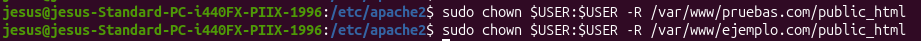
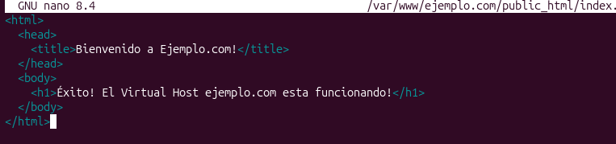
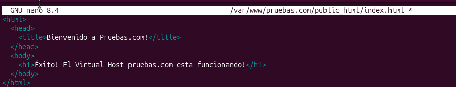
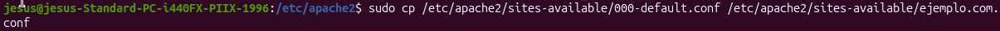
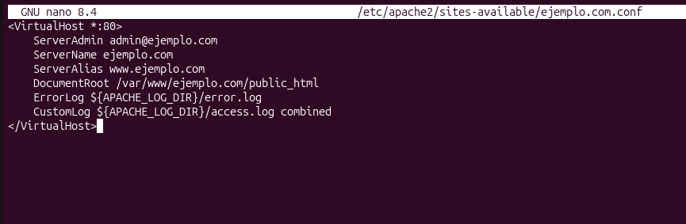

# Activiadad6 | VIRTUAL HOSTS
## Paso Uno - Crear la Estructura del Directorio
El primer paso que necesitamos es crear la estructura de directorios que mantendrán la información de nuestro sitio.
Esto hay que crearlo en ```/var/www``` ya que aquí es donde apache busca el contenido para mostrar, vamos a crear 2 directorios y dentro de esos directorios vamos a crear un archivo llamado ```public_html``` este archivo contendrá toda la información del sitio.
Para crear los directorios con el fichero tendremos que poner el siguiente comando en la terminal:
```bash
sudo mkdir -p /var/www/ejemplo.com/public_html
sudo mkdir -p /var/www/pruebas.com/public_html
```


## Paso Dos - Otorgar Permisos
Ahora hay que cambiar los permisos de los directorios que acabamos de crear para que el usuario regular pueda modificarlo ya que el propietario es root, para ello pondremos los siguientes comandos en la terminal:
```bash
sudo chown -R $USER:$USER /var/www/ejemplo.com/public_html
sudo chown -R $USER:$USER /var/www/pruebas.com/public_html
```



La variable ```$USER``` tomará el valor del usuario con el cual actualmente estás identificado. Al hacer esto, nuestro usuario regular ahora es propietario de los directorios public_html donde se almacenará nuestro contenido.

Tambien hay que modificar los permisos de ```/var/www``` para asegurarnos de que el permiso de lectura pueda ser aplicado correctamente
```bash
sudo chmod -R 755 /var/www
```


## Paso Tres — Crear una Página de Prueba para cada Virtual Host
Ahora vamos a crear los archivos ```index.html``` para cada virtual host vamos a empezar con ```ejemplo.com```:
Esto es lo que habría que poner en la terminal
```bash
nano /var/www/ejemplo.com/public_html/index.html
```
Con esto lo que estariamos haciendo seria abrir un editor de texto en la terminal.


Esto es lo que tendríamos que escribir dentro:
```html
<html>
  <head>
    <title>Bienvenido a Ejemplo.com!</title>
  </head>
  <body>
    <h1>Éxito! El Virtual Host ejemplo.com esta funcionando!</h1>
  </body>
</html>
```



Podemos copiar este archivo y usarlo de base para nuestro segundo sitio escribiendo o escribirlo de nuevo a mano:
```bash
cp /var/www/ejemplo.com/public_html/index.html /var/www/pruebas.com/public_html/index.html
```


Ahora abrimos el archivo que acabamos de copiar con nano y cambiamos lo que mencione ejemplo y lo sustituimos por pruebas, tendria que quedar asi:
```bash
<html>
  <head>
    <title>Bienvenido a Pruebas.com!</title>
  </head>
  <body>
    <h1>Éxito! El Virtual Host pruebas.com esta funcionando!</h1>
  </body>
</html>
```



## Paso Cuatro — Crear Nuevos Archivos Virtual Host
Los archivos Virtual Host son archivos que contienen información y configuración específica para el dominio y que le indican al servidor Apache como responden a las peticiones de varios dominios.
Apache incluye un archivo Virtual Host por defecto denominado 000-default.conf que podemos usar para saltarnos al punto. Vamos ha hacer una copia de este para ahorrarnos tiempo.

### Crear el Archivo Virtual Host
Vamos a copiar el archivo 
```bash
sudo cp /etc/apache2/sites-available/000-default.conf /etc/apache2/sites-available/ejemplo.com.conf
```



Ahora vamos a abrir el nuevo archivo:
```bash
sudo nano /etc/apache2/sites-available/ejemplo.com.conf
```


El archivo se vería tal que asi
```bash
<VirtualHost *:80>
    ServerAdmin webmaster@localhost
    DocumentRoot /var/www/html
    ErrorLog ${APACHE_LOG_DIR}/error.log
    CustomLog ${APACHE_LOG_DIR}/access.log combined
</VirtualHost>
```
Pero hay que cambiarle unas cosas las cuales serian:
Primero, necesitamos cambiar la directiva ServerAdmin por un correo del administrador del sitio que pueda recibir correos.
**ServerAdmin** admin@ejemplo.com
```ServerName```, que establece la base del dominio que debe coincidir para este Virtual Host.
```ServerAlias```, determina nombres futuros que pueden coincidir y servirse como el nombre base o dominio principal.
Esto es útil para host tipo ```www```
**ServerName** ejemplo.com
**ServerAlias** www.ejemplo.com
Para la configuración básica de un Virtual Host es la ubicación del directorio raíz para el dominio. Ya hemos creado lo que necesitamos, así que solo necesitamos modificar ```DocumentRoot```
**DocumentRoot** /var/www/ejemplo.com/public_html

Se tendria que ver asi:
```bash
<VirtualHost *: 80>
  ServerAdmin admin@ejemplo.com
  ServerName ejemplo.com
  ServerAlias www.ejemplo.com
  DocumentRoot /var/www/ejemplo.com/public_html
  ErrorLog ${APACHE_LOG_DIR}/error. log
  CustomLog ${APACHE_LOG_DIR}/access. log combined
</VirtualHost>
```



